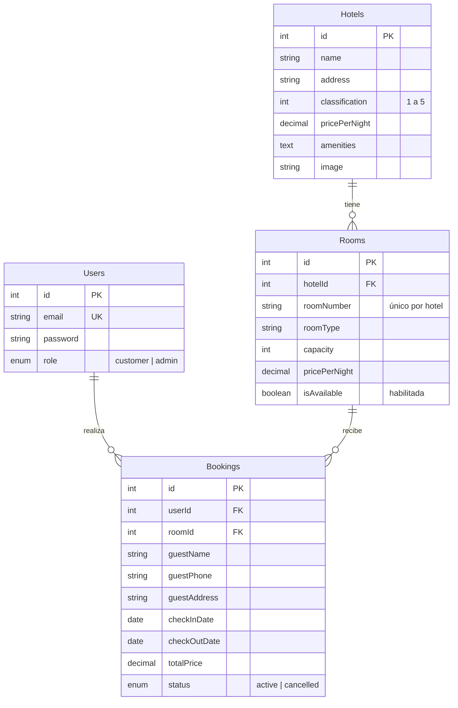

# 🏨 Tu Hotel

Aplicación web para consultar hoteles y reservar habitaciones. Los clientes buscan y reservan; los administradores gestionan el catálogo.

- **Frontend:** React 19 + Vite + React Router
- **Backend:** Node.js + Express 5 + Sequelize
- **Base de datos:** MySQL 8

## Funcionalidades

**Clientes**
- Registro e inicio de sesión (JWT).
- Búsqueda por destino, fechas, número de huéspedes y categoría: con fechas, **solo se muestran hoteles con habitaciones libres** en ese rango.
- Cada resultado muestra nombre, dirección, clasificación, precio por noche, comodidades y habitaciones.
- Reserva en tres pasos: datos del huésped → **revisión del resumen** → confirmación.
- Consulta de reservas próximas, pasadas y canceladas, y cancelación de las propias.

**Administradores**
- Crear, editar y eliminar hoteles.
- Crear, editar, habilitar/deshabilitar y eliminar habitaciones.
- Ver todas las reservas del sistema.

**Reglas de negocio**
- No se permiten dos reservas activas de la misma habitación en fechas que se solapen.
- El precio total se calcula en el servidor (`noches × precio de la habitación`).
- El check-out debe ser posterior al check-in, y el check-in no puede estar en el pasado.
- **Política de cancelación:** gratuita hasta 48 horas antes del check-in (configurable en `backend/config/policy.js` y `frontend/src/utils/format.js`).
- Las cancelaciones conservan el registro (estado `cancelled`).

## Estructura del proyecto

```
tu-hotel/
├── backend/
│   ├── app.js                 # Punto de entrada del servidor
│   ├── seed.js                # Datos de prueba (¡borra las tablas!)
│   ├── config/                # Base de datos y variables de entorno
│   ├── controllers/           # Lógica de cada recurso
│   ├── middlewares/           # Autenticación JWT y manejo de errores
│   ├── models/                # Modelos Sequelize y relaciones
│   ├── routes/                # Definición de endpoints
│   └── utils/                 # AppError y asyncHandler
├── frontend/
│   └── src/
│       ├── api/               # Instancia de Axios
│       ├── components/        # Navbar, SearchBar, HotelCard, BookingModal, Modal, admin/...
│       ├── context/           # AuthContext (sesión) y ToastContext (notificaciones)
│       ├── hooks/             # useApi (carga de datos con estados de carga y error)
│       ├── utils/             # Formato de fechas/dinero y estado de las reservas
│       ├── pages/             # Home, Login, Register, MyBookings, AdminDashboard
│       └── index.css          # Sistema de diseño (colores, tipografía, componentes)
└── database/
    └── schema.sql             # Esquema SQL de referencia
```

## Requisitos

- Node.js 20 o superior
- MySQL 8.0.16 o superior (las restricciones `CHECK` solo se aplican desde esa versión)

## Instalación

### 1. Clonar el repositorio

```bash
git clone https://github.com/lauraS527/tu-hotel.git
cd tu-hotel
```

### 2. Base de datos

Crea la base de datos con el esquema incluido:

```bash
mysql -u root -p < database/schema.sql
```

> Alternativa: crea una base de datos vacía llamada `tuhotel_db` y el backend creará las tablas al arrancar (`sequelize.sync()`).

### 3. Backend

```bash
cd backend
npm install
cp .env.example .env
```

Edita `.env` con tus datos (ver la tabla de variables más abajo). Genera un secreto JWT seguro:

```bash
node -e "console.log(require('crypto').randomBytes(48).toString('hex'))"
```

Carga los datos de prueba y arranca el servidor:

```bash
npm run seed    # opcional, solo desarrollo: recrea las tablas con datos de ejemplo
npm run dev     # http://localhost:5000
```

### 4. Frontend

```bash
cd frontend
npm install
cp .env.example .env
npm run dev     # http://localhost:5173
```

## Variables de entorno

### Backend (`backend/.env`)

| Variable | Descripción | Ejemplo |
|---|---|---|
| `NODE_ENV` | `development` o `production` | `development` |
| `PORT` | Puerto del servidor | `5000` |
| `DB_HOST` | Host de MySQL | `localhost` |
| `DB_PORT` | Puerto de MySQL | `3306` |
| `DB_NAME` | Nombre de la base de datos | `tuhotel_db` |
| `DB_USER` | Usuario de MySQL | `root` |
| `DB_PASSWORD` | Contraseña de MySQL | — |
| `DB_SSL` | Usar SSL en la conexión | `false` |
| `JWT_SECRET` | Secreto para firmar tokens (mínimo 32 caracteres) | *(aleatorio)* |
| `JWT_EXPIRES_IN` | Duración del token | `8h` |
| `CORS_ORIGIN` | Orígenes permitidos, separados por comas | `http://localhost:5173` |

### Frontend (`frontend/.env`)

| Variable | Descripción | Ejemplo |
|---|---|---|
| `VITE_API_URL` | URL base de la API | `http://localhost:5000/api` |

> ⚠️ **Nunca subas los archivos `.env` a git ni los incluyas en ZIPs que compartas.** El servidor no arranca si falta `JWT_SECRET` o si usas un valor débil.

## Cuentas de prueba

Disponibles después de ejecutar `npm run seed`:

| Rol | Correo | Contraseña |
|---|---|---|
| Administrador | `admin@tuhotel.com` | `admin123` |
| Cliente | `cliente@tuhotel.com` | `user123` |

Son solo para desarrollo local. No las uses en un servidor público.

## API

URL base: `/api`. Las rutas protegidas requieren el header `Authorization: Bearer <token>`.

### Autenticación

| Método | Ruta | Acceso | Descripción |
|---|---|---|---|
| POST | `/auth/register` | Público | Crea una cuenta de cliente |
| POST | `/auth/login` | Público | Devuelve el token y el usuario |

### Hoteles y habitaciones

| Método | Ruta | Acceso | Descripción |
|---|---|---|---|
| GET | `/hotels` | Público | Lista hoteles con sus habitaciones. Filtros opcionales: `search`, `stars`, `guests`, `checkIn` y `checkOut` (AAAA-MM-DD) |
| GET | `/hotels/:id` | Público | Detalle de un hotel |
| POST | `/hotels` | Admin | Crea un hotel |
| PUT | `/hotels/:id` | Admin | Actualiza un hotel |
| DELETE | `/hotels/:id` | Admin | Elimina un hotel (falla si tiene reservas) |
| GET | `/hotels/:hotelId/rooms` | Admin | Todas las habitaciones del hotel (incluye deshabilitadas) |
| POST | `/hotels/:hotelId/rooms` | Admin | Crea una habitación en el hotel |
| PUT | `/rooms/:id` | Admin | Actualiza una habitación |
| DELETE | `/rooms/:id` | Admin | Elimina una habitación (falla si tiene reservas) |

### Reservas

| Método | Ruta | Acceso | Descripción |
|---|---|---|---|
| POST | `/bookings` | Autenticado | Crea una reserva |
| GET | `/bookings/my-bookings` | Autenticado | Reservas del usuario |
| PUT | `/bookings/:id/cancel` | Autenticado | Cancela una reserva propia (hasta 48 h antes del check-in) |
| GET | `/bookings` | Admin | Todas las reservas |

**Ejemplo: crear una reserva**

```http
POST /api/bookings
Authorization: Bearer <token>
Content-Type: application/json

{
  "roomId": 1,
  "guestName": "Carlos Pérez",
  "guestPhone": "+57 300 123 4567",
  "guestAddress": "Calle 10 #20-30",
  "checkInDate": "2026-11-01",
  "checkOutDate": "2026-11-05"
}
```

**Ejemplo: buscar hoteles con habitaciones libres**

```http
GET /api/hotels?search=playa&checkIn=2026-11-10&checkOut=2026-11-14&guests=2&stars=4
```

El total se calcula en el servidor. Errores comunes: `400` (datos o fechas inválidas), `404` (habitación inexistente) y `409` (habitación ya reservada en esas fechas).

**Formato de errores**

```json
{ "status": "fail", "statusCode": 409, "message": "La habitación ya está reservada en esas fechas." }
```

## Modelo de datos



El esquema SQL completo, con índices y restricciones, está en [`database/schema.sql`](database/schema.sql).

## Despliegue

> En el curso solo se entrega **el enlace de la aplicación desplegada**. Necesitas tres piezas en línea: la base de datos MySQL, el backend y el frontend (en ese orden).

- **Frontend (Vercel):** el archivo `vercel.json` ya redirige todas las rutas a `index.html` para que React Router funcione. Define `VITE_API_URL` en las variables de entorno del proyecto.
- **Backend y MySQL:** despliega el backend en un servicio de Node (por ejemplo Render o Railway) con una base de datos MySQL gestionada. Configura las variables de entorno, `NODE_ENV=production`, `DB_SSL=true` si el proveedor lo exige, y `CORS_ORIGIN` con la URL del frontend.
- No ejecutes `npm run seed` en producción: borra todas las tablas.

## Seguridad

- Contraseñas cifradas con bcrypt; el rol de administrador no se puede elegir al registrarse.
- Tokens JWT con expiración; el servidor exige un `JWT_SECRET` robusto.
- `helmet`, CORS restringido y límite de intentos en las rutas de autenticación.
- Los campos que se pueden modificar están limitados (sin asignación masiva).
- Los errores internos no se exponen al cliente en producción.

## Próximos pasos

- [ ] Pruebas automáticas de la API (Vitest/Jest + Supertest)
- [ ] Migraciones de base de datos (`sequelize-cli`)
- [ ] Paginación y filtros por fechas en `GET /hotels`
- [ ] Token en cookie `httpOnly`
- [ ] Integración continua con GitHub Actions
- [ ] Interfaz: estilos en CSS, notificaciones en lugar de `alert()`

## Licencia

ISC
